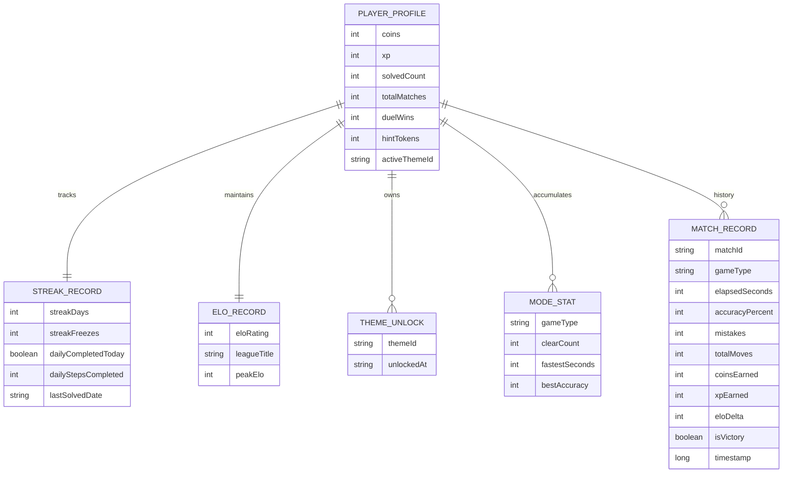

# SplitSignal — Database & State Persistence Schema (DATABASE.md)

## 1. Persistence Overview

SplitSignal is an **offline-first local-storage system**. In accordance with its privacy-first and zero-cloud principles, all player profiles, currency balances, streak logs, and cognitive telemetry are stored strictly on-device without remote sync dependencies.

The current production implementation uses an in-memory observable store (`ProgressionStore`) with serializable models that interface with local persistent storage (e.g., file-backed JSON / DataStore / platform key-value storage).

---

## 2. Entity-Relationship & State Schema



---

## 3. Data Dictionary

### 3.1 `ProgressionState`
| Field | Type | Default | Description |
|---|---|---|---|
| `streakDays` | `Int` | `6` | Current consecutive active daily streak |
| `dailyCompletedToday` | `Boolean` | `false` | Flag indicating if Today's workout or daily sprint was completed |
| `dailyStepsCompleted` | `Int` | `0` | Number of steps completed in today's 4-step workout (0–4) |
| `streakFreezes` | `Int` | `1` | Available consumable streak shield inventory |
| `coins` | `Int` | `250` | In-game currency balance |
| `xp` | `Int` | `840` | Total lifetime experience points |
| `elo` | `Int` | `1200` | Current competitive rating (starts at 1200) |
| `solvedCount` | `Int` | `12` | Total lifetime puzzles solved |
| `duelWins` | `Int` | `3` | Total 1v1 LAN duel victories |
| `totalMatches` | `Int` | `12` | Total competitive duel matches played |
| `fastestSolveSeconds` | `Int?` | `null` | All-time fastest solve duration |
| `bestAccuracyPercent` | `Int` | `100` | All-time highest puzzle accuracy |
| `modeClears` | `Map<GameType, Int>` | `{}` | Histogram of solves partitioned by GameType |
| `unlockedThemes` | `Set<BoardTheme>` | `[OBSIDIAN]` | Purchased board themes |
| `activeTheme` | `BoardTheme` | `OBSIDIAN` | Currently equipped UI board theme |
| `hintTokens` | `Int` | `2` | Consumable hints available across puzzle modes |

---

## 4. Elo Leagues Specification

Elo ratings are mapped deterministically via `EloLeague.forElo(elo: Int)`:

```
[0 — 1349]    -> Bronze Tactician
[1350 — 1549] -> Silver Strategist
[1550 — 1799] -> Gold Analyst
[1800 — 2099] -> Platinum Master
[2100+]       -> Grandmaster
```

### Dynamic Elo Delta Formulas:
- **1v1 Standard Duel Win:** `+24 Elo`
- **1v1 Standard Duel Loss:** `-14 Elo`
- **Triathlon Duel Win (3 Rounds):** `+36 Elo`
- **Solo Flawless under Par Time:** `+6 Elo`
- **Solo Regular Clear:** `+2 Elo`
- **Minimum Floor:** Clamped at `100 Elo`

---

## 5. Currency & Economy Configuration

### 5.1 Solve Rewards Calculation (`recordModeSolve`)
```kotlin
totalCoins = baseCoins + speedBonusCoins + flawlessBonusCoins
xpEarned = totalCoins * 2 + (bestCombo * 5) + (if (isDailyStep) 25 else 0)
```
- **Base Coins:**
  - Triathlon: `75 coins`
  - 9×9 Sudoku / KenKen: `45 coins`
  - Cross Math / Math Maze / Memory Matrix / Mindsnap: `35 coins`
  - Daily Step Bonus: `+20 coins`
  - 1v1 Race Win Bonus: `+30 coins`
- **Speed Bonus:**
  - `elapsed <= parSeconds / 2`: `+25 coins`
  - `elapsed <= parSeconds`: `+15 coins`
- **Flawless Bonus (0 mistakes):** `+20 coins`

### 5.2 The Vault Store Catalog
| Item | Cost | Effect |
|---|---|---|
| **Streak Freeze** | 100 Coins | Shields daily streak if a day is missed |
| **Hint / Peek Token** | 40 Coins | Reveals 1 valid cell or flashes 0.8s Memory Peek |
| **Paper Ivory Theme** | 120 Coins | High-contrast warm ivory editorial styling |
| **Monochrome Slate Theme**| 180 Coins | Deep Solarized slate theme |

---

## 6. Daily Challenge Calendar Mechanics
- Uses `kotlinx-datetime` UTC day-epoch as input to FNV-1a hashing:
  ```kotlin
  val dailySeed = Fnv1a.hash32("DAILY_WORKOUT:$dateEpoch:$stepIndex:$gameType")
  ```
- All users running the app on the same calendar day receive the **exact same procedural boards offline**, ensuring zero network dependency for global daily challenge parity.
