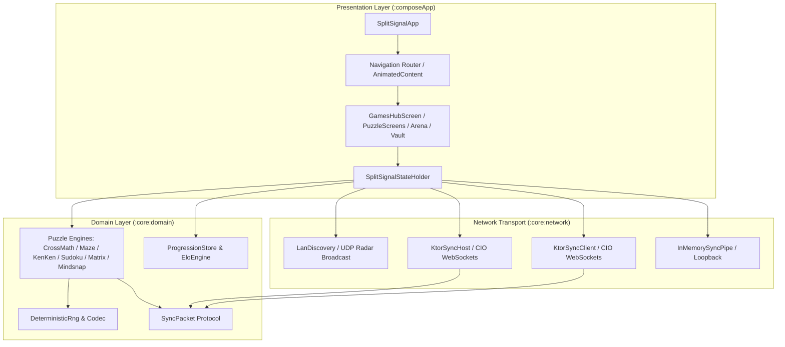

# SplitSignal — High-Level Design (HLD)

## 1. System Overview

**SplitSignal** is an offline, peer-to-peer, cooperative and competitive mathematical deduction gaming platform built with **Kotlin Multiplatform (KMP)** and **Compose Multiplatform**. It runs natively across **Android**, **Desktop (JVM)**, and **Web (Wasm-JS)**.

The game is designed with a **Zero-Internet** paradigm: all real-time multiplayer duels, room discovery, and state synchronization operate exclusively over **Local Area Network (LAN) / Wi-Fi Hotspots** via UDP broadcast beacons and Ktor CIO WebSockets.

---

## 2. Architectural Principles

1. **Deterministic State Synchronization:**
   - Game generation uses a pure 32-bit SplitMix pseudo-random generator (`DeterministicRng`) parameterized by an exact unsigned 32-bit seed (`UInt`).
   - Host and Client run identical deterministic algorithms independently from the synchronized seed, requiring only lightweight diff/progress telemetry over the network.

2. **Offline-First Zero-Cloud Design:**
   - Zero remote servers, cloud databases, or third-party auth services.
   - P2P matchmaking over local subnets using UDP broadcast radar (`255.255.255.255:45678`) and fallback 4-character invite codes (`CODE@IP:PORT`).

3. **Decoupled Layer Architecture:**
   - `:core:domain`: Pure Kotlin Multiplatform domain models, deterministic puzzle algorithms, game loop engines, and protocol packets. Zero Compose or Android dependencies.
   - `:core:network`: Engine-agnostic transport layer implementing Ktor WebSocket Host/Client and UDP LAN Discovery with platform actuals (`jvmAndAndroidMain`, `wasmJsMain`).
   - `:composeApp`: Unified Compose Multiplatform UI layer adhering to Linear-inspired minimalist design principles, spring physics, and unidirectional data flow (`SplitSignalStateHolder`).

---

## 3. High-Level System Architecture

---

## 4. Subsystems & Component Breakdown

### 4.1 Game Catalog (The 6 Matiks Puzzle Engines)
1. **Cross Math (`3×3` & `4×4`):** Intersecting arithmetic crosswords with BODMAS/PEMDAS order-of-operations evaluation and a bottom Number Bank.
2. **Math Maze (`4×4`):** Orthogonal pathfinding puzzle tracing cumulative integer calculations to an exact exit goal.
3. **KenKen / Calcudoku (`4×4` & `5×5`):** Latin square constraint propagation with irregular arithmetic cages (`+`, `−`, `×`, `÷`).
4. **Mini Sudoku (`6×6` & `9×9`):** Rapid backtracking Sudoku with unique-solution verification and constraint step difficulty grading.
5. **Memory Matrix + Math Recall:** Short-term visual spatial memory (2.0s reveal, 3D card flip) followed by target sum or ascending order recall.
6. **Mindsnap Blitz (60s):** Rapid-fire mental math drills with 4 choices and a rising `1x → 5x` Combo Fire Multiplier.

### 4.2 Competitive Modes
- **Solo Practice:** Infinite offline procedural puzzles with hint tokens and par time benchmarks.
- **Daily Brain Workout:** 4-step progressive daily workout (`Cross Math` → `Math Maze` → `KenKen` → `Mindsnap`) with streak tracking.
- **1v1 LAN Race / Duel:** Two devices playing the exact same seed over Wi-Fi/Hotspot with real-time opponent progress bars.
- **3-Round Triathlon Duel:** High-stakes consecutive competitive rounds (`Mindsnap` → `Memory Matrix` → `Cross Math`).
- **Co-op Asymmetric Deduction:** 2-player asymmetrical puzzle (Operator Number Grid + Analyst Clue Sheet).

### 4.3 Progression & Economy System
- **Elo Rating:** Competitive skill rating starting at 1200 Elo scaling across 5 leagues (`Bronze Tactician` to `Grandmaster`).
- **Currency & Streaks:** Coins and XP earned from solves, flawless runs, and speed bonuses.
- **The Vault:** Consumables (Streak Freezes, Hint Tokens) and Board Themes (`Obsidian Dark`, `Paper Ivory`, `Monochrome Slate`).

---

## 5. Technology Stack

| Layer | Technology |
|---|---|
| Language | Kotlin 2.1.20 |
| Framework | Compose Multiplatform 1.7.3 |
| Concurrency | Kotlinx Coroutines 1.10.1 & Flow |
| Serialization | Kotlinx Serialization JSON 1.8.0 |
| Networking | Ktor 3.1.1 (CIO Server & Client WebSockets, UDP sockets) |
| Dependency Injection | Koin 4.0.2 (`koin-core`, `koin-compose`) |
| Build System | Gradle 8.11.1 with Kotlin DSL & Convention Plugins |
| Supported Targets | Android (API 24–35), Desktop JVM (Java 17/21), Wasm-JS |
