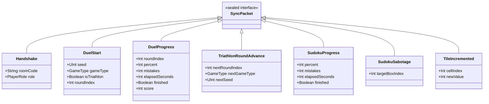
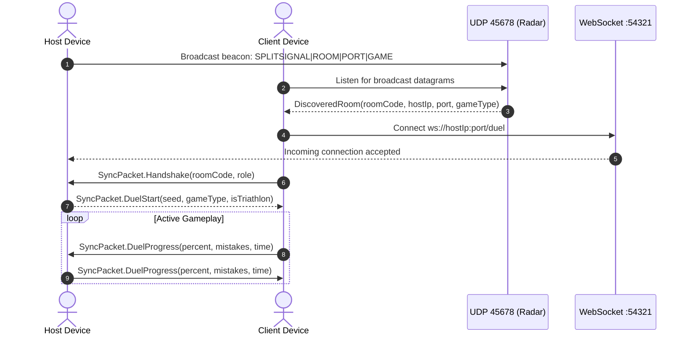
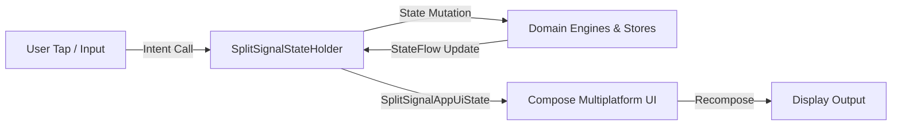

# SplitSignal — Low-Level Design (LLD)

## 1. Domain Layer Architecture (`:core:domain`)

The domain layer is completely decoupled from UI and platform APIs. It contains deterministic engines, procedural generators, wire protocol packets, and state containers.

### 1.1 Deterministic RNG & Seed Derivation
```kotlin
class DeterministicRng(seed: UInt) {
    fun nextUInt(): UInt
    fun nextInt(bound: Int): Int
    fun nextInt(from: Int, until: Int): Int
    fun nextFloat(): Float
    fun nextBoolean(): Boolean
    fun <T> shuffle(list: MutableList<T>)
}
```
- **Algorithm:** 32-bit SplitMix PRNG with custom state increment `0x9E3779B9u` and FNV-1a hash seeding.
- **Property:** Bit-exact deterministic sequences across ART (Android), HotSpot JVM, and JavaScript/Wasm VMs.

---

### 1.2 Wire Protocol Specification (`SyncPacket`)

All LAN communications between Host and Client are serialized via `kotlinx.serialization.json` as sealed polymorphic `SyncPacket` instances over WebSocket text frames:



---

### 1.3 Puzzle Engine Implementations

Each game mode follows a strict state engine pattern exposing an immutable `StateFlow<T>` and accepting suspendable user intents:

#### 1. Cross Math (`CrossMathEngine`)
- **Evaluator:** `CrossMathGenerator.evaluateBodmas(operands, ops)` implements two-pass operator precedence (`MUL`/`DIV` first with exact integer checks, then `ADD`/`SUB`).
- **State Model:**
  ```kotlin
  data class CrossMathGameState(
      val seed: UInt,
      val size: CrossMathSize,
      val board: CrossMathBoard,
      val values: List<Int?>,
      val bank: List<BankTile>,
      val selectedCellIndex: Int?,
      val rowSatisfied: List<Boolean>,
      val colSatisfied: List<Boolean>,
      val moves: Int,
      val mistakes: Int,
      val elapsedSeconds: Int,
      val percentComplete: Int,
      val isSolved: Boolean,
      val opponentProgress: OpponentProgress?
  )
  ```

#### 2. Math Maze (`MathMazeEngine`)
- **Generator:** `MathMazeGenerator.buildRandomPath()` performs biased random walks from `(0, 0)` to `(dim-1, dim-1)`, constructing orthogonal step arithmetic without negative intermediate divide-by-zero or non-integer division.
- **Intents:** `tapCell(index)`, `stepBack()`, `applyHint()`.

#### 3. KenKen (`KenKenEngine`)
- **Generator:** Builds Latin square permutations, partitions grid into contiguous irregular cages (1–3 cells), and assigns target operations.
- **Conflict Detector:** Identifies duplicate row/column entries and violated cage targets simultaneously.

#### 4. Sudoku Duel (`SudokuRaceEngine`)
- **Generator:** Randomized backtracking grid generator with hole-punching verification ensuring a single unique solution.
- **Hints:** Identifies Naked Singles and Hidden Singles logically without guessing.

#### 5. Memory Matrix (`MemoryMatrixEngine`)
- **Phases:** 2000ms reveal countdown -> Face-down recall -> Tap detection for target sum subsets or ascending order permutations.
- **Peek Hint:** 800ms temporary re-flash.

#### 6. Mindsnap Blitz (`MindsnapEngine`)
- **Deck Generator:** 12 rapid-fire questions (missing operators, rapid multiplication, division, addition/subtraction).
- **Multiplier Logic:** Rising combo streak `1x -> 5x` multiplying score bonuses.

---

## 2. Networking Layer (`:core:network`)



### 2.1 Transport Abstraction
```kotlin
interface SyncTransport {
    val incomingPackets: SharedFlow<SyncPacket>
    val connectionState: StateFlow<TransportConnectionState>
    suspend fun send(packet: SyncPacket)
    fun close()
}
```
- **Loopback Implementation:** `InMemorySyncPipe` with paired asynchronous buffer channels for zero-overhead solo play.
- **Host Transport:** Ktor CIO embedded WebSocket server binding dynamic/fixed ports.
- **Client Transport:** Ktor CIO WebSocket client with automatic reconnection lifecycle.
- **Discovery:** `JvmLanDiscovery` runs a background coroutine dispatching UDP broadcast packets once per second and evicting stale discovered rooms after 3500ms.

---

## 3. Presentation Architecture (`:composeApp`)

### 3.1 Unidirectional Data Flow (UDF)



### 3.2 UI Screen Router & Navigation
`SplitSignalApp.kt` controls top-level navigation using `AnimatedContent` with vertical slide-fade transitions:
- `AppScreen.HUB` -> `GamesHubScreen`
- `AppScreen.LOCAL_LINK` -> `LocalLinkScreen`
- `AppScreen.CROSS_MATH` -> `CrossMathScreen`
- `AppScreen.MATH_MAZE` -> `MathMazeScreen`
- `AppScreen.KENKEN` -> `KenKenScreen`
- `AppScreen.MEMORY_MATRIX` -> `MemoryMatrixScreen`
- `AppScreen.MINDSNAP` -> `MindsnapScreen`
- `AppScreen.SUDOKU_SOLO` / `SUDOKU_RACE` -> `SudokuScreen`
- `AppScreen.VAULT_SHOP` -> `VaultShopScreen`
- `AppScreen.STATS_PROFILE` -> `StatsProfileScreen`
- `AppScreen.COOP_ACTIVE` -> `MathPuzzleScreen` / `BattleshipScreen`
